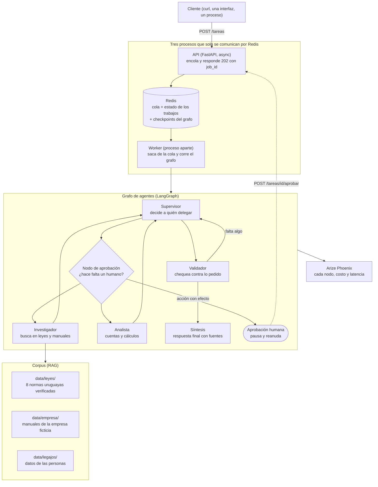

# The Intelligence System

Sistema de IA que responde consultas complejas sobre el derecho laboral uruguayo y sobre las políticas
internas de una empresa. Arma un equipo de agentes, los coordina con un supervisor y deja trazado todo lo
que pasa adentro.

Es el trabajo final del curso **AI Engineering** de Coderhouse. Lo armé juntando lo que hicimos módulo a
módulo: cliente multi-proveedor, cadenas, RAG, agentes, multi-agente con supervisor, API de producción con
cola y observabilidad.

## Qué hace

Le hacés una pregunta y el sistema arma un equipo para contestarla bien. Por ejemplo: "¿cuántos días de
licencia le corresponden a Ana Ferreira y cuánto cobra de salario vacacional?". Uno de los agentes busca en
las leyes y en los manuales de la empresa, otro hace las cuentas, un supervisor reparte el trabajo y valida
el resultado. La respuesta sale citando de dónde salió cada dato.

Si la tarea implica ejecutar algo con efecto real, el sistema se detiene y espera a que una persona
apruebe. Decidí que esa pausa no la dispare el modelo sino el código, así es auditable y repetible.

## Por qué elegí este tema

Me interesaba un dominio donde el sistema no pueda inventar. Con leyes y manuales internos, una respuesta
sin la cita al artículo no sirve, así que me obliga a que el RAG y las fuentes sean parte del resultado y
no un adorno. Además es un tema que conozco: trabajo con equipos y me toca ver consultas de licencias todo
el tiempo. Tuve que leer varias leyes para escribir el corpus, y me sirvió para darme cuenta de que el
error más común no es no saber, sino contestar de memoria.

## Cómo está armado



Para leer el dibujo: el cliente nunca espera, porque la API solo encola y contesta en milisegundos. El
trabajo pesado lo hace el worker, que es otro proceso. El estado vive en Redis. Gracias a eso un trabajo
puede pausarse para pedir aprobación y reanudarse después, aunque el servidor se haya reiniciado en el
medio. Cada nodo del grafo deja su traza en Phoenix.

El detalle de cada capa, con el porqué de cada decisión, está en
[`docs/arquitectura.md`](docs/arquitectura.md).

## De dónde saca las respuestas

El sistema no contesta de memoria, busca en documentos. Los armé en tres capas separadas a propósito,
porque tiene que poder distinguir lo que dice la ley de lo que decidió la empresa. Las fichas de leyes las
verifiqué una por una contra IMPO, MTSS y BPS: no me quise confiar de la memoria para ninguna cifra.

| Capa | Qué tiene | Real o inventado |
|---|---|---|
| `data/leyes/` | Ocho fichas de normas uruguayas (licencia, salario vacacional, aguinaldo, licencias especiales, jornada y horas extras, feriados, teletrabajo, desvinculación y seguro de paro). Cada una con el artículo y el link oficial | Real, verificado contra IMPO, MTSS y BPS |
| `data/empresa/` | Reglamento interno, política de licencias, teletrabajo, seguridad de la información y onboarding de Nordika S.A. | Inventado (empresa ficticia) |
| `data/legajos/` | Seis legajos de personas de esa empresa, con antigüedad, sueldo y situación de licencias | Inventado |

Lo medí con tiktoken: 20 documentos, 19.409 tokens y 54 fragmentos, con el chunking de 600 tokens y 100
de solapamiento. El documento más corto tiene 645 tokens, así que ninguno queda por debajo del umbral y
todos se parten en más de un fragmento. Qué es real y qué no lo aclaro en
[`data/README.md`](data/README.md).

## Cómo se corre

Con **un solo comando**, siempre que tengas el entorno virtual activado y el `.env` creado:

```bash
source .venv/bin/activate      # una vez
cp .env.example .env           # y completá la clave del modelo

./run.sh                       # levanta Redis (si hace falta), Phoenix, la API y el worker
```

Al final imprime las dos URLs (API en `localhost:8000`, dashboard de trazas en `localhost:6006`) y
confirma que Redis contesta. Para bajar todo: `./run.sh --parar`. Los registros quedan en `logs/`.

Con Docker es igual de corto y no hace falta tener nada instalado, sólo Docker:

```bash
docker compose up --build
```

Y si preferís verlo por partes, son dos procesos que van en dos terminales:

```bash
export PYTHONPATH=src                      # el código vive en src/
export REDIS_URL=redis://127.0.0.1:6379/0

uvicorn intelligence.main:app --port 8000  # terminal 1: la API
python -m intelligence.worker              # terminal 2: el worker
```

Los dos procesos validan el entorno al arrancar y dejan en el log en qué modo quedaron:

```
INFO arrancando: proveedor=gemini modelo=gemini-flash-latest recuperacion=lexico trazas=activas concurrencia=3
```

Se encola una consulta así:

```bash
curl -s -X POST localhost:8000/tareas -H 'content-type: application/json' \
  -d '{"pregunta":"¿Cuántos días de licencia le corresponden a Ana Ferreira, que entró en 2016, y cuánto cobra de salario vacacional por esos días?"}'
# {"job_id":"b685e9ddee6a","estado":"pendiente"}          <- contesta en 27 ms
```

Con el worker corriendo, esa consulta terminó así (es la salida real de la corrida, no un ejemplo escrito
a mano):

```
estado: done | pasos: 2 | contribuciones: investigador, analista

A Ana Ferreira le corresponden 22 días de licencia anual (20 días base + 2 por complemento de
antigüedad), de acuerdo con los registros de su legajo. Ya gozó 10 días durante el cierre colectivo
de enero, quedándole un saldo de 12 días.

El salario vacacional equivale al 100 % del jornal líquido ($ 4.010 por día):
  - por el total generado (22 días): $ 88.220
  - por los 12 días pendientes:      $ 48.120
```

## Las cinco corridas

Lo que pide la consigna: al menos cinco pruebas del sistema con las trazas visibles. En vez de mandar
cinco veces la misma consulta, va una corrida por escenario, contra la API real, con el worker en otro
proceso y Phoenix registrando. Salida cruda de `python scripts/escenarios.py`:

| Escenario | Resultado | Tiempo | Pasos | Quién aportó |
|---|---|---|---|---|
| 1. una sola capa (consulta de ley) | `done` | 70,8 s | 4 | investigador, analista |
| 2. dos dominios con cálculo | `done` | 51,4 s | 2 | investigador, analista |
| 3. acción con efecto, la persona aprueba | `done` | 30,4 s | 1 | investigador |
| 4. acción con efecto, la persona rechaza | `rechazado` | 6,1 s | 0 | — |
| 5. consulta sin cobertura del corpus | `done` | 21,3 s | 0 | — |

Tres cosas que muestran, y que son las que elijo mirar:

1. **La pausa funciona.** En el escenario 3 el trabajo quedó esperando aprobación con la instrucción a
   la vista y **cero pasos ejecutados**, y siguió después del OK. En el 4, el rechazo cerró el trabajo
   en 6 segundos.
2. **La consulta sin cobertura no se inventa nada**: *"Actualmente no dispongo de los datos sobre el
   costo de los pasajes a Miami para enero ni de recomendaciones específicas de hoteles (...) sin
   inventar números"*.
3. **El cálculo sale de la herramienta, no del modelo**: en el escenario 2 la respuesta trae los 21 días
   de licencia de Bruno (20 de la ley más el día que agrega Nordika a los 3 años) y el salario vacacional
   calculado con el jornal líquido de su legajo: 4.430 × 21 = **$ 93.030**.

## Las capturas y los números del dashboard

Las cuatro capturas están en [`screenshots/`](screenshots) y son del dashboard real, con el historial
limpio antes de la sesión (si no, el p95 mezcla corridas viejas):

| Captura | Qué muestra |
|---|---|
| `01-trazas.png` | Las seis trazas del proyecto, una por corrida más la de la prueba de la pausa |
| `02-trazas-del-grafo.png` | Una traza abierta: el árbol con los nodos (`supervisor`, `aprobacion`, `validacion`, `sintesis`) y arriba el costo y la latencia de esa ejecución |
| `03-latencia-costos.png` | La vista de métricas: el costo estimado, los percentiles de latencia (max, p50, p75, p90, p95, p99) y el consumo de tokens |
| `04-api-docs.png` | La API documentada y navegable que trae FastAPI (`/docs`), con los cuatro endpoints y sus esquemas |

Números leídos del dashboard después de las cinco corridas: **6 trazas**, **latencia P50 21 s**,
**P99 1 m 9 s**, y en la traza abierta **costo $ 0,01 con latencia 19,5 s**.

Dos notas honestas sobre estas métricas:

- **El costo.** La consigna pide el costo por ejecución, que la plataforma calcula desde los tokens. Con
  la capa gratis de Gemini ese costo da **$ 0,00**, así que dejo las dos capturas: la de costo (con la
  línea en cero) y la de **tokens** (más de 40.000 en la sesión), que es la métrica que se mueve de
  verdad. Corriendo con un proveedor pago, esa misma captura muestra el costo real.
- **El p95.** Con cinco corridas el p95 es prácticamente el máximo (el más lento fue 70,8 s). Por eso
  también anoto el P50 y el P99 del dashboard, que es lo que se ve en la captura de métricas.

## Lo que queda anotado

Nada de esto bloquea la entrega; lo dejo escrito porque lo vi y prefiero que esté dicho:

- En el escenario 1 el supervisor mandó **tres veces** al analista antes de cerrar: el validador no le
  reconoció el aporte a la primera y el corte por pasos terminó cerrando el trabajo. La respuesta salió
  bien, pero es lo próximo a afinar (que un aporte con la cuenta hecha cuente como aporte).
- El costo con la capa gratis del modelo da cero, como expliqué arriba.


## Requisitos

- **Python 3.12+**
- **Redis**, para la cola y los checkpoints del grafo
- **Docker**, si preferís no instalar Redis ni Phoenix a mano
- Una clave de modelo: Gemini (tiene capa gratis), OpenAI o Anthropic. Se elige con `LLM_PROVIDER`

Sin clave de Pinecone el recuperador arranca en modo léxico y el sistema funciona igual. Las claves no
entran al repo: se copia `.env.example` a `.env` y se completan ahí.

## Configuración

Una devolución anterior me marcó algo que me quedó: no degradar en silencio. Si el entorno no alcanza, el
sistema dice qué falta y de dónde sacarlo, en vez de explotar tres capas más adentro. Por ejemplo, con
`LLM_PROVIDER=gemini` y sin la clave:

```
falta GOOGLE_API_KEY: es la clave de gemini, que es el proveedor elegido en LLM_PROVIDER.
Se saca en https://aistudio.google.com/apikey (tiene capa gratis).
Si querés usar otro proveedor, cambiá LLM_PROVIDER (válidos: anthropic, gemini, openai).
```

## Las pruebas (137, sin claves y sin red)

```bash
python -m pytest tests -q
```

Las pruebas las corrí sin claves y sin red a propósito. Donde habría una llamada al modelo o a la nube hay
un doble, así cualquiera clona el repo y verifica que funciona sin pedir prestada una API key. Me parece
importante que se puedan correr sin depender de que yo tenga una clave a mano.
